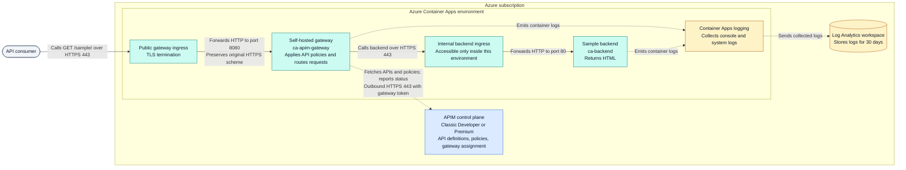

# Azure API Management self-hosted gateway on Container Apps

Deploy an Azure API Management (APIM) self-hosted gateway to **Azure Container Apps**
using Bicep and PowerShell. The gateway exposes a sample API over HTTPS and routes
requests to a backend that is reachable only inside the Container Apps environment.

The project includes repeatable deployment, existing-APIM support, dev/prod
profiles, configuration-aware readiness, bounded load testing, candidate promotion
with traffic restoration, token rotation, and GitHub Actions with OIDC.

> **Demo, not a production security baseline.** The gateway is public and the sample
> API requires neither a subscription key nor a JWT. The production profile changes
> APIM tier and gateway sizing; it does not add API authentication.
>
> **Azure charges apply.** Developer APIM is for nonproduction. Production uses
> classic Premium, with additional Container Apps and logging costs.

## Contents

- [Architecture](#architecture)
- [Quick start](#quick-start)
- [Deployment options](#deployment-options)
- [Configuration](#configuration)
- [Testing and verified results](#testing-and-verified-results)
- [Safe rollout and rollback](#safe-rollout-and-rollback)
- [Token rotation](#token-rotation)
- [GitHub Actions](#github-actions)
- [Operations and troubleshooting](#operations-and-troubleshooting)
- [Costs, limitations, and cleanup](#costs-limitations-and-cleanup)
- [Project layout](#project-layout)

## Architecture

### Request path, configuration, and logging



**Legend:** Rounded node = API consumer; blue box = APIM control plane;
teal boxes = request-serving components; amber box/cylinder = log collection/storage.
Solid arrows show API requests; dashed arrows show configuration/status requests
or log emission. Arrows follow the initiating request or log sender; responses
return along the reverse path and are omitted for clarity.

**Request flow**

1. The client calls the public gateway URL at `/sample/` over HTTPS.
2. Container Apps terminates TLS and forwards the request to gateway port `8080`.
   The gateway honors the forwarded HTTPS scheme.
3. The gateway matches the API operation, applies its policies, and calls the
   backend's internal HTTPS endpoint. Backend ingress forwards to port `80`.
4. The backend response returns through the gateway, whose outbound policy sets
   `X-Served-By: aca-gateway`, then through public ingress to the client.

APIM is the **management/control plane**: it holds the API definition, policies,
and gateway assignment. The self-hosted container is the **data plane** that
processes client requests. Requests do not need to traverse the cloud-managed
APIM gateway to reach the backend.

| Component | Purpose |
|---|---|
| APIM service | Stores API configuration and provides the gateway configuration endpoint |
| APIM gateway resource | Identifies the self-hosted gateway and its assigned APIs |
| Gateway container app | Public HTTPS ingress, gateway image `2.9.2`, HTTP target port `8080` |
| Readiness sidecar | Digest-pinned Python image; port `18081` translates configuration checks into HTTP 200/503 |
| Backend container app | Internal ingress, pinned sample image, target port `80` |
| API and policy | `GET /sample/`, with `X-Served-By` identifying the serving gateway |
| Log Analytics | Container application/system logging; workspace retention is 30 days |

Use the **Container Apps gateway URL**, not the APIM cloud gateway URL, for this
sample. The cloud-managed gateway cannot reach the internal backend in this topology.

Each new gateway revision includes a readiness sidecar. Container Apps checks
`/ready` on port `18081`; the sidecar calls the gateway over loopback at
`http://127.0.0.1:8080/gateway-health/ready`. It requires HTTP 200, the fixed
`X-Gateway-Ready: configured` marker, the expected `X-Served-By` gateway ID,
and the exact body `ready`. An unconfigured gateway's empty HTTP 200 therefore
becomes HTTP 503, not a healthy replica.

The readiness policy returns directly without calling the backend. A backend
outage must not restart the gateway. Startup/liveness use the listener status
endpoint; readiness proves loaded configuration, while rollout smoke/load checks
verify backend routing. Readiness does **not** prove configuration-service
connectivity or freshness of cached configuration. The public readiness route
reveals only fixed markers and the gateway ID.
Port `18081` avoids the gateway's own HTTPS listener on `8081`; containers within
a replica share the network namespace.

## Quick start

```powershell
git clone https://github.com/seilorjunior/apim-selfhosted.git
cd apim-selfhosted
```

### 1. Check prerequisites

Run the commands from the project root in **PowerShell 7.2 or later**.

| Tool or permission | Requirement |
|---|---|
| Azure CLI | Version 2.76+ for provider-level ARM validation |
| Bicep CLI | `bicep` executable available on `PATH` |
| Pester | Version 5+ for local regression tests |
| Python | Version 3.12+ on `PATH` as `python`; standard library only |
| Azure access | Permission to deploy resources and generate APIM gateway tokens |
| Azure cloud | Public Azure; sovereign clouds are not configured |

```powershell
$PSVersionTable.PSVersion
az version
bicep --version
Get-Module -ListAvailable Pester
python --version
```

If Bicep is missing, install it with `az bicep install` and add its installation
directory to `PATH`. For the default Windows Azure CLI installation:

```powershell
az bicep install
$env:Path = "$(Join-Path $HOME '.azure\bin');$env:Path"
bicep --version
```

If Pester 5+ is missing:

```powershell
Install-Module Pester -MinimumVersion 5.0 -Scope CurrentUser
```

A practical deployment identity needs Contributor on the target resource group,
plus permission to read provider registrations at subscription scope. When reusing
APIM in another resource group, it also needs appropriate access there.
The token operation requires
`Microsoft.ApiManagement/service/gateways/generateToken/action`; Contributor
includes it. Use narrower custom roles where required. Creating a resource group
or registering providers requires additional subscription-level permission.

### 2. Sign in and choose your target

Replace the example values before running:

```powershell
az login
az account list --query "[].{Name:name,Subscription:id}" --output table

$subscriptionId = 'YOUR-SUBSCRIPTION-ID'
$publisherEmail = 'you@contoso.com'
$resourceGroup = 'rg-apim-selfhosted'
$location = 'eastus2'
```

### 3. Register providers and create the resource group

Skip registration if the providers are already registered. An administrator can
perform this step if your deployment identity is resource-group scoped.

```powershell
foreach ($provider in @(
    'Microsoft.ApiManagement',
    'Microsoft.App',
    'Microsoft.OperationalInsights'
)) {
    az provider register --namespace $provider `
        --subscription $subscriptionId --wait
    if ($LASTEXITCODE -ne 0) { throw "Provider registration failed: $provider" }
}

az group create --name $resourceGroup --location $location `
    --subscription $subscriptionId
if ($LASTEXITCODE -ne 0) { throw 'Resource-group creation failed.' }
```

### 4. Validate and review the preview

```powershell
$deployment = @{
    SubscriptionId = $subscriptionId
    PublisherEmail = $publisherEmail
    ResourceGroup  = $resourceGroup
    Location       = $location
    Environment    = 'dev'
}

.\scripts\Test-Local.ps1
.\deploy.ps1 @deployment -ValidateOnly
```

Validation builds both Bicep entry points, checks provider registrations, runs
ARM validation with `--validation-level Provider`, and previews infrastructure
changes with what-if. It does not generate a token or deploy resources.
The resource group must already exist.

Gateway provider validation runs during deployment, after the Container Apps
environment exists. What-if does not guarantee capacity, quota, or successful
runtime startup.

### 5. Deploy

**This step creates billable resources.** Initial APIM provisioning can take
30-60 minutes or longer.

```powershell
.\deploy.ps1 @deployment
```

The script validates and previews changes again, then proceeds without an
interactive approval prompt:

1. Deploy infrastructure, the backend, and APIM API configuration as `shgw-infra`.
2. Generate a gateway token, valid for 29 days by default.
3. Add the required `GatewayKey ` authorization prefix.
4. Validate and deploy the gateway as `shgw-gateway`, using a fresh revision suffix.
5. Wait for that exact revision to become ready.
6. Verify `/sample/` returns HTTP 200 and the expected `X-Served-By` header.

Success ends with `Verified gateway: https://...; token expires: ...`.
A successful ARM deployment alone is **not** considered a successful smoke test.

### 6. Call the API

Retrieve the gateway address without exposing credentials:

```powershell
$gatewayFqdn = az deployment group show --name shgw-gateway `
    --resource-group $resourceGroup --subscription $subscriptionId `
    --query properties.outputs.gatewayFqdn.value --output tsv
if ($LASTEXITCODE -ne 0) { throw 'Gateway lookup failed.' }
$gatewayUrl = "https://$gatewayFqdn"

curl.exe -i "$gatewayUrl/sample/"
```

Expect HTML from the backend, HTTP 200, and `X-Served-By: aca-gateway`.
The header is a diagnostic routing check, not an authentication mechanism.

## Deployment options

### Dev and production profiles

| Setting | Dev | Prod |
|---|---|---|
| APIM tier | Classic Developer | Classic Premium |
| Default resource group | `rg-apim-selfhosted` | `rg-apim-selfhosted-prod` |
| Gateway app | `ca-apim-gateway` | `ca-apim-gateway-prod` |
| Gateway ID | `aca-gateway` | `aca-gateway-prod` |
| Backend app | `ca-backend` | `ca-backend-prod` |
| Gateway replicas | 1-3 | 2-6 |
| Gateway CPU / memory | 1 CPU / 2 GiB | 1 CPU / 2 GiB |
| HTTP scaling concurrency | 50 | 50 |
| Zone redundancy | Disabled | Disabled |

```powershell
.\deploy.ps1 -SubscriptionId $subscriptionId `
    -PublisherEmail $publisherEmail -Environment prod -Location $location
```

A full deployment can create a missing resource group if the caller has permission.
For a production validation-only preview, create the production resource group
first and pass `-Environment prod -ValidateOnly` with the same target values.

Developer has no production SLA. Two gateway replicas are not equivalent to
availability-zone redundancy or a tested high-availability design.

### Reuse an existing APIM service

```powershell
.\deploy.ps1 -SubscriptionId $subscriptionId `
    -ResourceGroup $resourceGroup -Location $location `
    -ExistingApimName 'my-existing-apim' `
    -ApimResourceGroup 'rg-existing-apim'
```

No publisher email is required. The service must be in the same subscription and
use classic Developer or Premium; prod requires Premium. The script reads the
actual existing SKU before proceeding.

The APIM service itself is not redeclared, but the API module **does manage**
`sample-api`, its policy, and the configured gateway. Check these names first:
deploying over matching resources can replace their configuration.

### Rerun safely

Infrastructure and gateway use separate **incremental** deployments. Deploying
infrastructure alone does not clear the existing gateway token or remove the
gateway app. Full deployment manages the sample API, policy, backend, and gateway.
Do not use complete deployment mode for these entry points.

## Configuration

Start with the [dev profile](infra/parameters/dev.parameters.json) or
[prod profile](infra/parameters/prod.parameters.json). To keep local overrides
outside version control:

```powershell
Copy-Item .\infra\parameters\dev.parameters.json `
    .\infra\parameters\dev.local.parameters.json

# Edit the copied ARM parameter file, then:
.\deploy.ps1 @deployment `
    -ParametersFile .\infra\parameters\dev.local.parameters.json
```

The file's `environmentName` must match `-Environment`. Command-line values for
publisher email/name, APIM SKU, existing APIM name, and APIM resource group
override file values when supplied. `-Location` always sets location.

| Parameter | Purpose |
|---|---|
| `baseName`, `gatewayName`, `gatewayAppName`, `backendAppName` | Resource naming |
| `tags` | Custom resource tags; project/environment tags are set by the template |
| `gatewayImageTag`, `backendImage` | Explicit gateway version and pinned backend image |
| `gatewayMinReplicas`, `gatewayMaxReplicas` | Scaling bounds; prod requires at least two minimum replicas |
| `gatewayConcurrentRequests` | HTTP concurrency scaling threshold |
| `gatewayCpu`, `gatewayMemory` | Gateway-only pairs: `0.5`/`1Gi`, `1.0`/`2Gi`, `1.75`/`3.5Gi`; readiness adds `0.25`/`0.5Gi` |
| `zoneRedundant`, `infrastructureSubnetId` | Opt-in zonal environment using an existing suitable subnet |
| Script `TokenDays` | Token validity, 1-30 days; default 29 |
| Script `TimeoutSeconds` | Revision-readiness and smoke-test polling budgets; default 600 seconds each |

Concurrency 50 is a starting configuration, not a measured capacity limit.
Load-test representative APIs before selecting production scaling settings.
`TimeoutSeconds` does not limit the total duration of APIM provisioning.

Zone redundancy requires a supported region and a suitable dedicated infrastructure
subnet. This template uses a consumption-only environment, requiring at least /23
for VNet integration. Validate current regional/network requirements first.
Zone redundancy cannot be enabled in place on an existing environment. Neither
profile creates a VNet or enables private gateway ingress.

### Replace the sample API

The [OpenAPI 3.0 contract](api/sample.openapi.json) is version `1.0.0`.
The [API module](infra/modules/api.bicep) imports it, sets the internal backend URL,
applies the [policy](api/policies/sample.xml), and assigns the API to the gateway.

When adopting a real API, update the contract, backend mapping, API name/path,
policies, and smoke-test expectations together. An OpenAPI document version does
not automatically create an APIM API version set. The diagnostic header uses
`context.Deployment.Gateway.Id`, not the APIM service name.

## Testing and verified results

### Choose a test scope

Run commands from the repository root in PowerShell 7.2+. Use the
[prerequisites](#1-check-prerequisites) for Python, Pester, and Bicep.

| Scope | Requirements | Effect |
|---|---|---|
| Local regression suite | Local tools; no Azure sign-in | Builds templates and runs mocked deployment and runtime tests |
| Live readiness and smoke checks | An existing gateway; network access to its HTTPS origin | Sends a few requests; no deployment or restart |
| Bounded load test | Permission to test the target environment | Sends up to 600 requests; can generate Azure usage/logging charges |
| Candidate load gate | Azure deployment permissions and settings | Deploys a candidate and conditionally promotes it; see [safe rollout](#safe-rollout-and-rollback) |

Run local tests first, then live functional checks, then the load test. Restart
and outage rehearsals are separate operations and are not part of this sequence.

### Local regression tests

```powershell
.\scripts\Test-Local.ps1
```

Builds both templates, parses PowerShell scripts, and runs the
[Pester deployment suite](tests/Project.Tests.ps1),
[rollout/rollback suite](tests/Rollout.Tests.ps1), and
[Python runtime tests](tests/test_runtime.py). They cover configuration guards, internal
ingress, probes/scaling, secure token parameters, raw/prefixed token handling,
fresh revisions, cleanup of temporary files, smoke retries, and mocked deployment
and restart flows, false-positive readiness, load thresholds/pacing/concurrency,
promotion ordering, traffic restoration, and rollback safeguards.
Azure dependencies are mocked; no Azure sign-in or resource
changes are needed, although the CLI tools must be installed.

Success prints Python `OK` and a Pester summary with zero failures. The current
suite contains 13 Python tests and 52 Pester tests. Any build, parse, or test
failure stops the script with an error.

### Live smoke and negative-route checks

Set the origin for your deployment. Do not include `/sample/` in `$gatewayUrl`.
If the quick-start variables are already set, retrieve the address with:

```powershell
$appName = 'ca-apim-gateway'
$expectedGatewayId = 'aca-gateway'
$fqdn = az containerapp show --name $appName `
    --resource-group $resourceGroup --subscription $subscriptionId `
    --query properties.configuration.ingress.fqdn --output tsv
if ($LASTEXITCODE -ne 0 -or !$fqdn) { throw 'Cannot resolve the gateway origin.' }
$gatewayUrl = "https://$fqdn"
```

Alternatively, set `$gatewayUrl` directly to your deployed HTTPS origin. Azure
CLI sign-in is needed for address discovery, not for public HTTP checks. For prod,
set `$appName = 'ca-apim-gateway-prod'` and
`$expectedGatewayId = 'aca-gateway-prod'`.

Verify loaded configuration and backend routing:

```powershell
. .\scripts\Common.ps1
Wait-GatewayConfiguration -GatewayUrl $gatewayUrl `
    -ExpectedGatewayId $expectedGatewayId -TimeoutSeconds 60

.\scripts\Test-Gateway.ps1 -GatewayUrl $gatewayUrl `
    -ExpectedGatewayId $expectedGatewayId -TimeoutSeconds 60

$sample = Invoke-WebRequest -Uri "$gatewayUrl/sample/" -TimeoutSec 15
if ($sample.StatusCode -ne 200 -or
    [string]$sample.Headers['X-Served-By'] -cne $expectedGatewayId -or
    $sample.RawContentLength -le 0) {
    throw 'Sample response status, gateway identity, or body is invalid.'
}
```

Inspect negative routes:

```powershell
curl.exe -i "$gatewayUrl/not-found"
curl.exe -i -X POST "$gatewayUrl/sample/"
```

Both responses must be HTTP 404. `curl.exe` displays those responses but does
not fail automatically for HTTP error status codes. To assert them in a script:

```powershell
foreach ($test in @(
    @{ Path = '/not-found'; Method = 'GET' },
    @{ Path = '/sample/'; Method = 'POST' }
)) {
    $response = Invoke-WebRequest -Uri "$gatewayUrl$($test.Path)" `
        -Method $test.Method -TimeoutSec 15 -SkipHttpErrorCheck
    if ($response.StatusCode -ne 404) {
        throw "Expected HTTP 404 for $($test.Method) $($test.Path); got $($response.StatusCode)."
    }
}
```

| Check | Expected response |
|---|---|
| `GET /gateway-health/ready` | HTTP 200, `X-Gateway-Ready: configured`, expected `X-Served-By`, exact body `ready` |
| `GET /sample/` | HTTP 200, expected `X-Served-By`, nonempty backend body |
| `GET /not-found` | HTTP 404 |
| `POST /sample/` | HTTP 404 because the operation is not configured |

Readiness and smoke helpers retry for up to the supplied timeout and throw if
their checks never pass. An empty HTTP 200 is not proof of a configured gateway.
HTTP requests to public ingress redirect to HTTPS.

### Bounded load test

Run against an environment you own and have permission to test:

```powershell
# Short preliminary run: at most 100 scheduled requests.
.\scripts\Test-Load.ps1 -GatewayUrl $gatewayUrl `
    -ExpectedGatewayId $expectedGatewayId `
    -RequestsPerSecond 10 -DurationSeconds 10 -MaxConcurrency 10

# Full bounded run: at most 600 scheduled requests.
.\scripts\Test-Load.ps1 -GatewayUrl $gatewayUrl `
    -ExpectedGatewayId $expectedGatewayId `
    -RequestsPerSecond 10 -DurationSeconds 60 -MaxConcurrency 10
```

The script caps requests at **10 RPS, 60 seconds, and 10 in flight**: at most
600 scheduled requests. Each request must return HTTP 200, the expected gateway
header, and a nonempty body. Redirects fail. Requests time out after five seconds.
It uses fixed monotonic-clock slots rather than accumulating sleep overhead.
There is at most one submission per scheduled slot; expired slots are dropped
rather than replayed in catch-up bursts. Saturated or missed slots are reported
as dropped requests. Individual send times remain subject to client scheduling
jitter.

Default gates are **p95 <= 2,000 ms**, **error rate <= 1%**, and **zero dropped
requests**. Errors include failed requests and dropped slots. The script exits
nonzero when a gate fails. Optional `-MaxP95Milliseconds`, `-MaxErrorRate`, and
`-OutputPath` customize gates/report location, not the hard load caps.

JSON reports default to ignored `TestResults/load-<timestamp>-<id>.json` and
include request counts, drops by reason, p95/p99/max latency, error rate, observed concurrency,
throughput, thresholds, and pass/fail. Latency includes client/network overhead;
this small test is **not a production capacity or autoscaling certification**.

### Read a load report and investigate failures

The command prints the report path, including when a threshold fails. Read that
specific report; do not substitute an older successful run. To inspect the latest
local report:

```powershell
$latestReport = Get-ChildItem -LiteralPath .\TestResults -Filter 'load-*.json' |
    Sort-Object LastWriteTimeUtc -Descending | Select-Object -First 1
if (!$latestReport) { throw 'No load report found.' }
$report = Get-Content -LiteralPath $latestReport.FullName -Raw | ConvertFrom-Json
$report | Select-Object passed, plannedRequests, startedRequests, `
    successfulRequests, failedRequests, droppedRequests, errorRate, `
    p95Ms, p99Ms, maxLatencyMs, maxObservedConcurrency
$report.droppedByReason
$report.failureExamples
```

| Report field or failure | Meaning and next check |
|---|---|
| `failedRequests` | Requests started but failed validation or transport; inspect `failureExamples`, readiness, and gateway/backend logs |
| `droppedByReason.concurrencyLimit` | A scheduled slot found all allowed requests in flight; inspect latency, client networking, and gateway/backend metrics |
| `droppedByReason.scheduleLate` | The client missed a scheduling slot; inspect client CPU load, scheduling delays, and competing tests |
| `droppedByReason.durationElapsed` | The client reached the end of the request-launch window before submitting a slot |
| `errorRate` | `(failedRequests + droppedRequests) / plannedRequests`; `0.01` means 1% |
| High `p95Ms` | Investigate client/network overhead and gateway/backend response latency |
| `passed: false` with zero failed requests | Drops or latency can still fail the overall gate; successful HTTP responses alone do not establish a pass |

The maximum duration bounds request scheduling; outstanding requests can finish
after that window. `maxObservedConcurrency` includes pending submitted work.
One run cannot establish whether saturation originates in the client, network,
gateway, or backend. Keep failed reports, investigate the cause, and record any
rerun separately. Do not silently relax thresholds or raise the hard load caps
to turn a failed run into a pass.

On GitHub, the [CI workflow](.github/workflows/ci.yml) runs the local suite only.
The [deployment workflow](.github/workflows/deploy.yml) can run the candidate load
gate with its manual `load_test` input and uploads generated reports. It requires
the Azure/OIDC configuration described in [GitHub Actions](#github-actions).

### Latest test snapshot: October 20, 2026

| Check | Observed result |
|---|---|
| Local suite | 52 Pester and 13 Python tests passed; Bicep builds and PowerShell parsing passed |
| Live functional checks | Configuration readiness and sample API passed; unknown route and unsupported POST returned 404 |
| Full bounded load | 600 scheduled; 598 started and succeeded; zero failed requests |
| Dropped slots | 2, both due to the concurrency limit |
| Latency | p95 445.85 ms; p99 900.57 ms; maximum 1,107.65 ms |
| Error rate including drops | 0.333%, within the 1% gate |
| Overall load verdict | Failed because the zero-dropped-request gate was not met |

This run did not restart, redeploy, or change traffic. It does not replace the
earlier successful candidate load result below; each result describes its own run.

### Observed results: October 19, 2026

The deployed dev environment was verified with the following results. These are
a **dated snapshot**, not a guarantee of future availability or performance.

| Check | Observed result |
|---|---|
| Bicep builds and local regressions | 33 tests passed; zero failures |
| `GET /sample/` | HTTP 200, nonempty backend HTML, `X-Served-By: aca-gateway` |
| Unknown route / unsupported POST | HTTP 404 / HTTP 404 |
| Gateway status endpoint | HTTP 200 |
| HTTP-to-HTTPS redirect | HTTP 301 |
| 20 sequential API requests | 20 passed; zero status/header/body failures |
| Request latency | Median 380.4 ms; p95 405.3 ms; max 422.5 ms |

The live negative checks and latency sample were run separately from the local
Pester suite. Latency includes client/network overhead. Twenty sequential requests
are **not a load test**, an autoscaling test, or evidence of production capacity.

### Readiness and controlled-rollout verification: October 19, 2026

The updated dev deployment was verified separately:

| Check | Observed result |
|---|---|
| Local regression suite | 52 Pester + 13 Python tests passed |
| Configuration-aware readiness | Healthy candidate; public `/gateway-health/ready` returns the exact markers and `ready` body |
| Candidate load | 600 scheduled/started; 599 successful, 1 request error (`URLError`), zero dropped |
| Load error rate | 0.167%, within the configured 1% maximum |
| Load latency | p95 585.34 ms; p99 797.40 ms; maximum 5,048.44 ms |
| Load concurrency | Maximum observed 9; configured cap 10 |
| Promotion | Verified candidate receives 100% of traffic; previous healthy release remains active at 0% |
| Failure handling | Earlier rejected candidates left previous traffic restored and the public API verified; failed candidates deactivated |
| Manual rollback | Live `-WhatIf` resolved the retained prior release without moving traffic |
| Public routes after promotion | Sample 200 with gateway header and 8,893-byte body; unknown route 404 |

The accepted load run retained the default gates; its single request error was
not hidden or treated as a success. Reports are local generated files, not
committed test fixtures. Manual rollback was previewed, not executed as a
traffic-switch rehearsal.

## Token rotation

Rotate before expiry; the default token lifetime is 29 days.

```powershell
.\deploy.ps1 -SubscriptionId $subscriptionId `
    -ResourceGroup $resourceGroup -Environment dev -RotateTokenOnly
```

For prod, supply `-Environment prod` and the production resource group.
Publisher information is not needed for rotation.

- Rotation reads the saved settings from the successful `shgw-infra` deployment.
  Keep that deployment history; rerun a full deployment to recreate it if removed.
- The token API returns a raw token. The script adds `GatewayKey ` exactly once
  before supplying `config.service.auth`.
- A new revision suffix forces the container to consume the updated secret.
  Updating a Container Apps secret alone does not restart existing containers.
- Rotation uses the same controlled multiple-revision rollout described below,
  keeping the serving revision pinned until candidate checks pass.
- Rotation does not regenerate signing keys or immediately revoke old tokens.
- Token files live in an owner-restricted temporary directory and are removed in
  `finally`; Bicep parameters are secure and GitHub Actions masks generated tokens.

Never commit tokens, put them in environment profiles, upload generated parameter
files, or enable CLI debug/HTTP tracing around credentials. Shorter `TokenDays`
values require a correspondingly more frequent rotation schedule.

## Safe rollout and rollback

For an existing healthy gateway, deployment and rotation:

1. Identify the single revision currently receiving 100% traffic and baseline-test
   its public API. Existing manual traffic splits are rejected rather than overwritten.
2. Keep that revision pinned at 100%; create the candidate with 0% public traffic.
3. Wait for the **exact candidate revision** to become healthy, including its
   configuration-aware readiness probe.
4. Check configuration markers and the sample backend through the candidate's
   revision-specific HTTPS FQDN. These candidate endpoints are public under the
   existing ingress configuration.
5. If requested, run the bounded load gate against that candidate.
6. Move 100% of public traffic to the candidate, then smoke-test the public URL.
7. On failure, restore previous traffic, verify the public API, and deactivate the
   failed candidate. Restoration/cleanup errors explicitly fail the command and
   require inspection. On success, retain the current and previous active releases;
   deactivate older releases to avoid accumulating active-revision costs.

**First deployment exception:** no prior release exists. The initial revision
gets 100% traffic and has no rollback target; checks still must pass.

To include the candidate load gate in deployment:

```powershell
.\deploy.ps1 -SubscriptionId $subscriptionId -ResourceGroup $resourceGroup `
    -PublisherEmail $publisherEmail -Environment dev -RunLoadTest
```

To preview or perform a later manual rollback:

```powershell
.\scripts\Rollback-Gateway.ps1 -SubscriptionId $subscriptionId `
    -ResourceGroup $resourceGroup -WhatIf

.\scripts\Rollback-Gateway.ps1 -SubscriptionId $subscriptionId `
    -ResourceGroup $resourceGroup
```

Rollback prompts for confirmation and defaults to the app's
`shgwPreviousRevision` tag. Use `-RevisionName` for an explicit revision belonging
to the app. It activates an inactive target if needed, verifies health,
configuration and backend before moving traffic, then verifies the public URL.
On failure it restores and verifies the formerly serving release. A successful
rollback records that release as the next rollback target. For prod, supply
`-AppName ca-apim-gateway-prod -ExpectedGatewayId aca-gateway-prod`.

**Rollback scope:** this restores gateway revision traffic, not APIM API/policy
changes, backend infrastructure, or app-scoped secrets. Those are shared across
revisions. Full deployment updates APIM configuration before candidate creation;
use backward-compatible API/policy changes and separate versioning when needed.
Traffic restoration is not a transaction across Azure resources or a guarantee
of zero downtime.

## GitHub Actions

| Workflow | Trigger | Behavior |
|---|---|---|
| [CI](.github/workflows/ci.yml) | Pull requests and pushes to `main` | Bicep builds and local regression tests |
| [Deployment](.github/workflows/deploy.yml) | Manual dispatch | `validate`, `deploy`, or `rotate`; defaults to validation |
| Same deployment workflow | Opt-in schedule | Weekly token rotation; never provisions initial infrastructure |

Both workflows use Windows runners and PowerShell. No repository, Azure identity,
or GitHub environment is provisioned by these files.

1. Push the project to a GitHub repository.
2. Create GitHub environments `dev` and `prod`. Configure required reviewers and
   allowed deployment branches for prod before using it. YAML alone cannot enforce
   environment protection.
3. Configure an Entra application/service principal or user-assigned managed
   identity with GitHub OIDC federation and the Azure permissions described above:
   - Issuer: `https://token.actions.githubusercontent.com`
   - Audience: `api://AzureADTokenExchange`
   - Subject: `repo:OWNER/REPO:environment:dev` or `repo:OWNER/REPO:environment:prod`
4. Set the following **GitHub environment variables**, not client secrets:

   | Variable | Required value |
   |---|---|
   | `AZURE_CLIENT_ID` | Federated identity client ID |
   | `AZURE_TENANT_ID` | Tenant ID |
   | `AZURE_SUBSCRIPTION_ID` | Target subscription ID |
   | `AZURE_RESOURCE_GROUP` | Precreated target resource group |
   | `AZURE_LOCATION` | Optional; defaults to `eastus2` |
   | `APIM_PUBLISHER_EMAIL` | Required when creating APIM |
   | `EXISTING_APIM_NAME` | Optional existing APIM service |
   | `APIM_RESOURCE_GROUP` | Optional existing APIM resource group |

5. Dispatch `validate`, review what-if, then dispatch `deploy`. Local checks and
   live verification must pass for a successful deployment job.
   Enable the manual `load_test` input to run the capped candidate load gate.
   Load reports are uploaded as workflow artifacts, including failed gate results.
   Scheduled token rotation does not enable load testing.

To enable weekly rotation, set repository variable `ENABLE_SCHEDULED_ROTATION`
to `true` and `SCHEDULED_ROTATION_ENVIRONMENT` to `dev` or `prod` (default: `dev`).
The schedule runs **Mondays at 06:00 UTC**, from the default branch, for one
environment. Protected environments still require approval before the token expires.
Use separate workflows/schedules if both environments need automatic rotation.

Actions serializes deployments per environment. Do not deploy locally at the same
time as a workflow targeting that environment. Generated token files are not
published as workflow artifacts.

## Operations and troubleshooting

### Inspect deployments and logs

```powershell
az deployment group show --name shgw-infra `
    --resource-group $resourceGroup --subscription $subscriptionId `
    --query properties.provisioningState --output tsv

az deployment group show --name shgw-gateway `
    --resource-group $resourceGroup --subscription $subscriptionId `
    --query properties.provisioningState --output tsv

az containerapp logs show --name ca-apim-gateway `
    --resource-group $resourceGroup --subscription $subscriptionId `
    --type console --tail 40
```

For production logs, use app name `ca-apim-gateway-prod`. Use `--type system`
for platform events such as startup or revision failures.

| Symptom | What to check |
|---|---|
| Provider not registered | Register the named provider explicitly; the deployment script does not register it silently |
| `bicep` not found | Ensure the standalone executable is on `PATH`, not just callable through `az bicep` |
| Unsupported APIM SKU | Use classic Developer/Premium; prod requires Premium |
| HTTP 200 with empty body and no gateway header | Inspect gateway logs for tenant/configuration startup failure; HTTP 200 alone is not proof of routing |
| `No valid authentication was configured` | Verify the secret includes `GatewayKey ` and rerun rotation with the corrected script |
| Configuration cannot load | Check token expiry, outbound HTTPS/DNS, and `<apim-name>.configuration.azure-api.net` reachability |
| Gateway secret changed but behavior did not | Use token rotation to force a new revision, rather than changing only the secret |
| New revision never becomes ready | Inspect console/system logs; check image, resources, network, and token configuration |
| Rotation cannot find settings | Check subscription/resource group and the `shgw-infra` deployment history |
| Optional CLI extension fails before any command | Repair that extension or use an empty session-specific `AZURE_EXTENSION_DIR`; do not broadly change filesystem permissions |

Startup/liveness probes verify the HTTP listener; readiness uses the sidecar's
configuration assertion. The API smoke test separately verifies backend routing.
If readiness fails, select the `readiness` container when inspecting console logs
and check the `/gateway-health/ready` response markers. The missing authorization-prefix
case was observed and corrected during the initial deployment, and is covered by
regression tests. Older retained revisions can still have their original probes;
they are checked explicitly before manual rollback.

### Restart rehearsal

Run only when a temporary interruption is acceptable:

```powershell
.\scripts\Test-Restart.ps1 -SubscriptionId $subscriptionId `
    -ResourceGroup $resourceGroup -GatewayUrl $gatewayUrl
```

The script prompts before restarting the ready revision and smoke-tests before
and after restart. It restarts all replicas of that revision and proves recovery,
not zero downtime. `-WhatIf` performs the baseline smoke check and previews the
restart without executing it. For prod, also set `-AppName ca-apim-gateway-prod`
and `-ExpectedGatewayId aca-gateway-prod`.

### Configuration-service outage rehearsal

This test is **not automated or executed by the normal test suite**. Use an isolated,
disposable environment with controlled egress; the default deployment does not
create the VNet/firewall needed for fault injection.

1. Pass the live smoke test and record a rollback procedure for the firewall rule.
2. Block only outbound HTTPS to the APIM configuration endpoint. Preserve backend
   connectivity, DNS, and Container Apps platform dependencies.
3. Check whether existing replicas continue serving their in-memory configuration.
   Record results, and verify an APIM policy update does not propagate while blocked.
4. Separately test restart while blocked. There is no persistent configuration
   backup in this project; a replacement replica cannot be assumed to bootstrap
   offline. Record actual startup/API availability rather than trusting status probes.
5. Restore connectivity even if checks fail, rerun smoke checks, and confirm the
   policy update propagates.

Do not run this rehearsal against shared or production environments.

## Costs, limitations, and cleanup

- Budget for APIM, applicable self-hosted gateway billing/licensing, minimum
  Container Apps replicas, Log Analytics ingestion/retention, and optional networking.
- The readiness sidecar adds **0.25 CPU / 0.5 GiB per replica**, in addition to the
  gateway's profile resources (default combined allocation: 1.25 CPU / 2.5 GiB).
  The consumption-only environment limits the combined replica to 2 CPU / 4 GiB;
  the largest gateway-only pair is now 1.75 CPU / 3.5 GiB, not the former 2 / 4.
  Both current and retained previous revisions remain active with their own
  minimum replica counts. Expect additional cost; deactivate an old revision
  manually only when accepting loss of immediate ready rollback.
- Classic Developer is nonproduction. Do not substitute another tier, including
  Premium v2, without verifying current self-hosted gateway support.
- API authentication, private ingress, WAF, custom domains, API access dashboards,
  persistent offline configuration backup, and multi-region failover are not included.
- Container Apps logs are configured; alerting and end-to-end API tracing require
  additional observability design.
- Public ingress, a second replica, and a prod parameter file do not establish a
  complete production security or availability posture.

**Cleanup is destructive.** For a dedicated demo resource group only, inspect its
contents, then use the interactive deletion command if you want to remove it:

```powershell
az resource list --resource-group $resourceGroup --subscription $subscriptionId `
    --query "[].{Name:name,Type:type}" --output table

# Deletes every resource in this group after confirmation:
az group delete --name $resourceGroup --subscription $subscriptionId
```

Do not delete a shared resource group. If APIM was reused in a different group,
deleting the Container Apps group does not remove the API/policy or gateway from
that APIM service; clean up only those project-owned entities separately if needed.

## Project layout

| Path | Responsibility |
|---|---|
| [deploy.ps1](deploy.ps1) | Preflight, deployment, token handling, revision rollout, smoke verification |
| [infra/main.bicep](infra/main.bicep) | APIM creation, Container Apps environment/backend, logging, API module |
| [infra/gateway.bicep](infra/gateway.bicep) | Gateway app, secure secret reference, probes, scaling, revision |
| [infra/modules/api.bicep](infra/modules/api.bicep) | API import, policy, gateway resource, API assignment |
| [infra/parameters/](infra/parameters/) | Version-controlled dev/prod profiles |
| [api/sample.openapi.json](api/sample.openapi.json) | Sample API contract |
| [api/policies/sample.xml](api/policies/sample.xml) | Gateway identity response header |
| [api/policies/readiness.xml](api/policies/readiness.xml) | Configuration-only readiness operation |
| [gateway/readiness.py](gateway/readiness.py) | Sidecar translating exact gateway markers into probe status |
| [scripts/Test-Local.ps1](scripts/Test-Local.ps1) | Local validation/test entry point |
| [scripts/Test-Gateway.ps1](scripts/Test-Gateway.ps1) | Live API smoke test |
| [scripts/Test-Load.ps1](scripts/Test-Load.ps1) | Bounded load-test entry point and gates |
| [scripts/load_test.py](scripts/load_test.py) | Paced standard-library load engine and JSON report |
| [scripts/Rollout.ps1](scripts/Rollout.ps1) | Candidate promotion, traffic restoration, revision retention |
| [scripts/Rollback-Gateway.ps1](scripts/Rollback-Gateway.ps1) | Confirmed rollback to a verified revision |
| [scripts/Test-Restart.ps1](scripts/Test-Restart.ps1) | Confirmed restart/recovery rehearsal |
| [scripts/Common.ps1](scripts/Common.ps1) | Shared validation, CLI, secret-file, and polling helpers |
| [tests/Project.Tests.ps1](tests/Project.Tests.ps1) | Pester regression suite |
| [tests/Rollout.Tests.ps1](tests/Rollout.Tests.ps1) | Promotion and rollback regression tests |
| [tests/test_runtime.py](tests/test_runtime.py) | Readiness and load-engine unit/integration tests |
| [.github/workflows/](.github/workflows/) | CI and OIDC deployment/rotation workflows |

## License

This project is licensed under the [MIT License](LICENSE). Referenced container
images and third-party services retain their own terms.

## References

- [Deploy a self-hosted gateway to Container Apps](https://learn.microsoft.com/azure/api-management/how-to-deploy-self-hosted-gateway-container-apps)
- [Self-hosted gateway overview](https://learn.microsoft.com/azure/api-management/self-hosted-gateway-overview)
- [Gateway container settings](https://learn.microsoft.com/azure/api-management/self-hosted-gateway-settings-reference)
- [Gateway token REST API](https://learn.microsoft.com/rest/api/apimanagement/gateway/generate-token?view=rest-apimanagement-2024-05-01)
- [Container Apps secret management](https://learn.microsoft.com/azure/container-apps/manage-secrets)
- [Container Apps reliability](https://learn.microsoft.com/azure/reliability/reliability-azure-container-apps)
