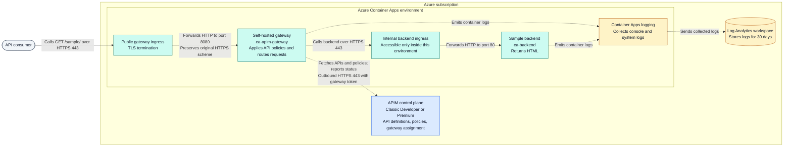

# Architecture

[Project overview](../README.md). Run commands from the repository root.

## Architecture

### Request path, configuration, and logging

**Legend:** Rounded node = API consumer; blue box = APIM control plane;
teal boxes = request-serving components; amber box/cylinder = log collection/storage.
Solid arrows show API requests; dashed arrows show configuration/status requests
or log emission. Arrows follow the initiating request or log sender; responses
return along the reverse path and are omitted for clarity.

**Request flow**

1. The client calls the public gateway URL at `/sample/` over HTTPS.
2. Container Apps terminates TLS and forwards the request to gateway port `8080`.
   The gateway honors the forwarded HTTPS scheme.
3. The gateway matches the API operation, applies its policies, and calls the
   backend's internal HTTPS endpoint. Backend ingress forwards to port `80`.
4. The backend response returns through the gateway, whose outbound policy sets
   `X-Served-By: aca-gateway`, then through public ingress to the client.

APIM is the **management/control plane**: it holds the API definition, policies,
and gateway assignment. The self-hosted container is the **data plane** that
processes client requests. Requests do not need to traverse the cloud-managed
APIM gateway to reach the backend.

| Component | Purpose |
|---|---|
| APIM service | Stores API configuration and provides the gateway configuration endpoint |
| APIM gateway resource | Identifies the self-hosted gateway and its assigned APIs |
| Gateway container app | Public HTTPS ingress, gateway image `2.9.2`, HTTP target port `8080` |
| Readiness sidecar | Digest-pinned Python image; port `18081` translates configuration checks into HTTP 200/503 |
| Backend container app | Internal ingress, pinned sample image, target port `80` |
| API and policy | `GET /sample/`, with `X-Served-By` identifying the serving gateway |
| Log Analytics | Container application/system logging; workspace retention is 30 days |

Use the **Container Apps gateway URL**, not the APIM cloud gateway URL, for this
sample. The cloud-managed gateway cannot reach the internal backend in this topology.

Each new gateway revision includes a readiness sidecar. Container Apps checks
`/ready` on port `18081`; the sidecar calls the gateway over loopback at
`http://127.0.0.1:8080/gateway-health/ready`. It requires HTTP 200, the fixed
`X-Gateway-Ready: configured` marker, the expected `X-Served-By` gateway ID,
and the exact body `ready`. An unconfigured gateway's empty HTTP 200 therefore
becomes HTTP 503, not a healthy replica.

The readiness policy returns directly without calling the backend. A backend
outage must not restart the gateway. Startup/liveness use the listener status
endpoint; readiness proves loaded configuration, while rollout smoke/load checks
verify backend routing. Readiness does **not** prove configuration-service
connectivity or freshness of cached configuration. The public readiness route
reveals only fixed markers and the gateway ID.
Port `18081` avoids the gateway's own HTTPS listener on `8081`; containers within
a replica share the network namespace.
